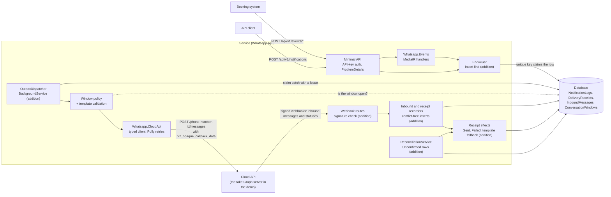

# whatsapp-cloud-notifications

A reliable transactional-notification service that talks to the **Meta WhatsApp Cloud API** directly. Booking events
(created, status changed) become WhatsApp messages with exactly one row per notification, per-tenant credentials, correct
handling of WhatsApp's 24 hour service window, typed error handling and retries, signed inbound and status webhooks, and an
explicit answer to "what if we do not know whether it was sent". The product surface is an HTTP API; there is no front end.

## Why

Sending one WhatsApp message is easy. Sending it reliably is not:

- the booking system retries, so the same event arrives twice, and a customer must not get two messages;
- the provider is sometimes slow, throttled or down, and that must never fail the booking request;
- every tenant has its own number and token, and credentials must never mix;
- free-form text is only allowed within 24 hours of the customer's last message, templates are allowed any time;
- some errors deserve a retry (rate limit, 5xx) and some must stop (invalid number, expired token);
- the provider can accept a message and the caller still never hear about it, and then neither a resend nor silence is
  obviously right.

## What is core and what is an addition

A minimal Cloud API integration is the typed client, templates, the 24 hour rule and the HTTP API. This repository goes
beyond that, and says so. Everything marked **addition** is optional to adopt and can be removed without touching the core.

| Part | Scope |
| --- | --- |
| Typed Cloud API client with transient/permanent classification, per-call tenant options, E.164, templates, free-text renderer, window policy, HTTP API | core |
| **Outbox** with claim-first idempotency, leased dispatcher, backoff and dead-lettering | addition |
| **Webhooks**: verify-token handshake, `X-Hub-Signature-256` verification, tolerant parsing, replay safety, inbound messages opening the 24 hour window | addition |
| **Delivery receipts**: append-only storage, derived delivery status, effects of a failed receipt, template fallback | addition |
| **Unconfirmed state and reconciler**: `biz_opaque_callback_data`, a state for sends of unknown outcome, an at-most-once or at-least-once policy | addition |

## Architecture



How a message travels:

1. A booking system posts an event, or a client posts a custom notification. The API authenticates the key (which
   identifies the tenant), validates the request and normalises the phone number to E.164.
2. The event handler (or the endpoint) **only enqueues**. The row is inserted first; a unique index on
   `(tenant, recipient, event key, reference key)` decides races, and a repeat returns the existing row as a duplicate.
3. The dispatcher claims due rows with a lease, resolves the tenant options, applies the service-window policy,
   validates template data, and sends through the Cloud API client. The notification id goes along as
   `biz_opaque_callback_data`.
4. The outcome is written to the row: `Sent`, `Skipped`, `Failed`, `DeadLettered`, `Unconfirmed` (the provider may have
   accepted it), or back to `Pending` with a backoff.
5. The provider later posts **signed webhooks**. Inbound customer messages open the 24 hour window; status events are
   stored as receipts and give the notification a delivery status (`Sent`, `Delivered`, `Read`, `Failed`). A receipt
   that echoes the notification id also confirms an `Unconfirmed` row.
6. The reconciler resolves `Unconfirmed` rows that no receipt confirmed within the grace period, by the configured policy.

## Project layout

```text
WhatsappNotifications.slnx
src/
  Whatsapp.Abstractions   contracts: client, tenant options, typed errors, window, outbox and webhook interfaces, booking snapshot
  Whatsapp.CloudApi       typed HttpClient, payload builder, error classifier, Polly retries, E.164 normaliser, config tenants
  Whatsapp.Templates      template registry and validator, builder, status labels, free-text renderer (EN/AR), booking details
  Whatsapp.Outbox         EF Core context and migrations, claim-first enqueuer, leased dispatcher, window stores, receipts, reconciler
  Whatsapp.Webhooks       signature verification, tolerant payload parser, webhook processor and metrics
  Whatsapp.Events         MediatR 12.x notifications and enqueue-only handlers
  Whatsapp.Api            minimal API: auth, endpoints, health, OpenAPI, ProblemDetails, correlation ids
  Whatsapp.FakeGraph      stand-in for the Cloud API: send endpoint, failure injection, signed webhooks, inbound simulation
tests/
  Whatsapp.Tests              unit and API contract tests (SQLite files, fake clock)
  Whatsapp.IntegrationTests   concurrency on SQLite, the fake Graph server, the whole service end to end
docs/
  openapi.json            the committed OpenAPI document (a test fails if it drifts)
  adr/                    architecture decision records
requests/                 .http files, one request per endpoint (VS Code REST Client / JetBrains HTTP client)
```

## Run it

Requirements: the .NET 10 SDK. Nothing else: no containers, no database server, no credentials. The demo runs on SQLite
and a fake Graph server that stands in for the Cloud API. Use three terminals (the apps keep running):

```bash
dotnet run --project src/Whatsapp.FakeGraph -- --environment Development --urls http://localhost:5103
dotnet run --project src/Whatsapp.Api -- --environment Development --urls http://localhost:5102
curl -s -X POST http://localhost:5102/api/v1/events/booking-created -H "X-Api-Key: dev-only-tenant-a-key-not-a-secret" -H "Content-Type: application/json" -d '{"bookingId":"bk-1","reference":"REF-1","customerFirstName":"Sam","phoneCountryCallingCode":"1","phoneNationalNumber":"2025550100","bookingType":"Hotel","status":"Confirmed","details":{"checkInDate":"2026-03-14"},"companyName":"Acme Travel","createdAt":"2026-03-01T09:30:00Z","whatsappUpdatesEnabled":true}'
```

The API listens on http://localhost:5102 and the fake Graph server on http://localhost:5103. A second after the last
command, `curl -s http://localhost:5103/_inspect/messages` shows the message the fake "Cloud API" received, and a few
seconds later `curl -s http://localhost:5103/_inspect/webhooks` shows the signed `sent`, `delivered` and `read` webhooks it
posted back. On the SDK used here `dotnet run` consumes `--environment` itself, which is why the application arguments
come after `--`. Stop both with Ctrl+C. The demo database is the file `src/Whatsapp.Api/whatsapp.db` (ignored by git); delete it to start
from an empty database.

Then walk through the whole story in [`requests/notifications.http`](requests/notifications.http): 50 requests covering
every endpoint (booking created, the fake Graph server, duplicate events, receipts, the window opened by a signed inbound
webhook, the handshake, failure injection, a failed receipt, an answer dropped after the provider accepted the message, and
admin retries). A signature cannot be written by hand in a `.http` file, so signed webhooks are posted by the fake through
its inspect endpoints. [`requests/fakegraph.http`](requests/fakegraph.http) covers the fake server itself.

All keys and secrets in `appsettings.Development.json` (both projects) are obviously fake demo values.

### Pointing the service at the real Cloud API

Nothing is hard-coded. Configure tenants with environment variables (or any configuration source) and keep tokens and
secrets in your secret store; never commit them. The default `ISecretProvider` reads the `Secrets` section.

| Setting | Meaning | Default |
| --- | --- | --- |
| `Whatsapp__Tenants__{id}__PhoneNumberId` | the phone number id of the sending number; also how a webhook finds its tenant | required |
| `Whatsapp__Tenants__{id}__BaseUrl` | the Graph API base URL including the API version, without a trailing slash | required |
| `Whatsapp__Tenants__{id}__AccessTokenSecret` | the **name** of the secret that holds the access token | required |
| `Whatsapp__Tenants__{id}__Enabled` | `false` switches the tenant off: its messages are skipped | `true` |
| `Whatsapp__Tenants__{id}__DefaultTemplateLanguage` | used when a notification does not name a template language | `en` |
| `Whatsapp__Tenants__{id}__ServiceWindowEnabled` | `false` disables the 24 hour rule for the tenant | `true` |
| `Whatsapp__Tenants__{id}__WebhookAppSecretName` | **addition.** The name of the secret holding the app secret that signs the tenant's webhooks. Without it the tenant's webhooks are ignored | none |
| `Whatsapp__Tenants__{id}__WebhookVerifyTokenName` | **addition.** The name of the secret holding the token the subscription handshake must present | none |
| `Secrets__{name}` | the secret itself (access token, app secret, verify token) | none |
| `Whatsapp__Webhooks__MaxBodyBytes` | **addition.** Largest webhook body accepted; larger is a 413 | `1048576` |
| `Whatsapp__Reconciliation__GracePeriod` | **addition.** How long an `Unconfirmed` notification waits for a receipt | `00:15:00` |
| `Whatsapp__Reconciliation__OnGraceExpired` | **addition.** `DeadLetter`: at most once, never send again automatically. `Resend`: at least once, may deliver twice | `DeadLetter` |
| `Whatsapp__Reconciliation__PollInterval`, `__Enabled`, `__BatchSize` | **addition.** Reconciler pass interval, on/off switch, rows examined per pass | `00:00:30`, `true`, `200` |
| `Whatsapp__Outbox__MaxAttempts`, `__LeaseDuration`, `__PollInterval`, `__BatchSize`, `__Concurrency`, `__RetryBaseDelay`, `__RetryMaxDelay`, `__DispatcherEnabled`, `__SchemaMode` | **addition.** Outbox tuning (`SchemaMode`: `Auto` migrates on PostgreSQL and creates the schema from the model on SQLite) | see `appsettings.json` |
| `Whatsapp__ConversationWindow__Duration` | length of the window an inbound message opens (at most 24 hours; write `1.00:00:00`) | `1.00:00:00` |
| `Whatsapp__Client__MaxRetryAttempts`, `__RetryBaseDelay`, `__MaxInlineRetryDelay`, `__RequestTimeout` | in-process retries and timeout of the Cloud API client | `2`, `00:00:00.5`, `00:00:05`, `00:00:30` |
| `Whatsapp__Events__PreferFreeTextWithinWindow` | queue booking events as free text with the template as fallback | `false` |
| `Api__AdminKey`, `Api__TenantKeys__{n}__TenantId`, `Api__TenantKeys__{n}__Key` | API keys, at least 16 characters | required |
| `Database__Provider`, `Database__ConnectionString` | `Postgres` or `Sqlite` | `Sqlite` in `appsettings.json` |

To receive webhooks from the real provider, subscribe the callback URL `https://<your host>/api/v1/webhooks/whatsapp` with the
verify token and app secret you configured. Templates must exist (and be approved) in your business account under the same
name and language. The built-in ones are `booking_created` (customer name, company name, module, created date, details) and
`booking_status_updated` (customer name, reference, status); more can be declared under `Whatsapp:Templates`.

The fake Graph server has its own settings under `FakeGraph:Webhook` (`CallbackUrl`, `AppSecret`, `SentDelay`,
`DeliveredDelay`, `ReadDelay`, `Outcomes`); without a callback URL and an app secret it posts nothing.

## Tests

```bash
dotnet build -warnaserror                      # zero warnings
dotnet test                                    # everything: unit, API, concurrency and end-to-end tests
dotnet test --filter "Category!=Integration"   # the unit and API set only
```

Nothing but the SDK is needed: the tests use SQLite files, the API through `WebApplicationFactory`, an in-process fake Graph
server and a fake clock.

Regenerating the committed OpenAPI document after an intentional API change:

```bash
UPDATE_OPENAPI=1 dotnet test --filter "FullyQualifiedName~OpenApiSnapshotTests"
# PowerShell: $env:UPDATE_OPENAPI=1; dotnet test --filter "FullyQualifiedName~OpenApiSnapshotTests"
```

Last full run (2026-11-19): `dotnet build -warnaserror` 0 warnings, 0 errors; `dotnet test` 599 unit and API tests and 47
integration tests passed, none failed or skipped.

### What is proven where

Every row names test classes that were run for this README. "Fake" means the fake Graph server, never the live API.

| Claim | Proven by | Against |
| --- | --- | --- |
| The Cloud API payloads are exactly right (text, template, `biz_opaque_callback_data`) | `GraphPayloadBuilderTests` | golden JSON |
| Responses and the error envelope are parsed; errors are classified transient or permanent | `GraphResponseParserTests`, `WhatsappErrorClassifierTests` | tables |
| Transient errors are retried (also with `Retry-After`), permanent ones are not; a failure that may have been sent is not retried and has an unknown outcome | `WhatsappCloudClientTests` | stubbed HTTP, fake clock |
| Phone numbers are normalised to E.164 for several regions; tokens and numbers are masked | `PhoneNumberNormalizerTests`, `SensitiveDataTests` | unit |
| Templates are validated, built and labelled; free text renders in EN and AR | `TemplateValidatorTests`, `TemplateBuilderTests`, `TemplateRegistryTests`, `StatusLabelMapTests`, `FreeTextRendererTests`, `BookingDetailsFormatterTests` | unit |
| One row and one send per key under many parallel enqueues; no error-level log line on a duplicate; failed SQL is still logged | `OutboxSqliteConcurrencyTests`, `ConflictFreeEnqueueTests` | SQLite; the PostgreSQL statement as generated text only |
| The committed migrations match the model | `MigrationTests` | model snapshot (not executed on a server) |
| The dispatcher: success, retry schedule, dead-letter, a lease that expired becomes `Unconfirmed`, disabled tenant | `OutboxProcessorTests` | SQLite, fake clock |
| Event handlers only enqueue, and are registered exactly once | `BookingEventHandlerTests`, `MediatRRegistrationTests` | real DI container |
| The 24 hour rule: inside, outside, fallback, skip, exactly 24 hours, forward-only | `ConversationWindowTests`, `WebhookWindowTests` | SQLite, fake clock |
| Handshake, signature (valid, tampered, wrong secret, missing, wrong prefix, empty, oversize), tolerant parsing, replays, unknown phone number | `WebhookSignatureTests`, `WebhookPayloadParserTests`, `WebhookProcessorTests`, `WebhookApiTests` | golden fixtures, real API host |
| Receipts: every arrival order ends the same, `failed` is terminal, a receipt before `Sent`, unknown message ids, failure effects, template fallback exactly once | `ReceiptTests`, `DeliveryStatusDerivationTests`, `ReceiptApiTests` | SQLite |
| Unconfirmed sends: crash after accept then receipt gives one message and one `Sent` row; no receipt gives a dead letter (at most once) or a resend (at least once); reconciler against dispatcher has one winner | `UnconfirmedTests`, `UnconfirmedApiTests`, `EndToEndWebhookTests` | fault-injecting client, fake clock, fake |
| The fake Graph server signs its webhooks so the service's verifier accepts them, drops an answer after accepting, simulates inbound messages | `FakeGraphTests` | fake |
| The whole loop: booking event, send, signed receipts, inbound webhook, failed receipt, dropped answer | `EndToEndTests`, `EndToEndWebhookTests` | service and fake, in process |
| API contracts, authentication, ProblemDetails, correlation ids, health | `ApiNotificationTests`, `ApiEventTests`, `ApiInfrastructureTests` | real API host |
| The OpenAPI document is the committed one | `OpenApiSnapshotTests` | generated document |
| Every request of `requests/notifications.http` (50) and `requests/fakegraph.http` (13) returns its documented status | run by hand on 2026-11-19 against `dotnet run` processes started with the commands above: 50 of 50 and 13 of 13, with a content check on 15 steps of the first file; no `fail` or `crit` log line in either process | not an automated test |
| The README run blocks work as written | the two `dotnet run` commands as detached processes, then the `curl` commands verbatim: 202, one message at the fake, three signed webhooks answered 200 | not an automated test |

## API overview

All routes are under `/api/v1`. Every request needs an `X-Api-Key` header, except the health endpoints and the two webhook
routes (their callers are authenticated by verify token and by signature). A tenant key identifies the tenant; the admin key
is for admin routes and has no tenant. Errors are RFC 7807 `application/problem+json`; every response carries an
`X-Correlation-Id` (accepted from the caller or generated).

| Method and route | Key | Scope | Purpose | Success |
| --- | --- | --- | --- | --- |
| `POST /notifications` | tenant | core | Queue a custom notification (template, or free text with optional template fallback) | 202, or 200 with `duplicate: true` |
| `GET /notifications/{id}` | tenant or admin | core, receipts are an addition | One notification with its receipt timeline and derived `deliveryStatus` (tenants see only their own) | 200 |
| `GET /notifications?status=&deliveryStatus=&recipient=&tenantId=&page=&pageSize=` | admin | core | List, newest first | 200 |
| `POST /notifications/{id}/retry` | admin | addition | Requeue a `Failed`, `DeadLettered` or `Unconfirmed` notification | 202 (409 otherwise) |
| `POST /events/booking-created` | tenant | core | Publish a booking-created event | 202 |
| `POST /events/booking-status-changed` | tenant | core | Publish a status change (skipped without customer opt-in) | 202 |
| `POST /admin/conversations/inbound` | admin | **demo only** | Simulate an inbound customer message through the same recorder as the webhook | 200 |
| `GET /webhooks/whatsapp` | verify token | addition | Subscription handshake: echoes `hub.challenge` as plain text | 200 (403 otherwise) |
| `POST /webhooks/whatsapp` | signature | addition | Signed delivery of inbound messages and status events | 200 (401 unsigned, 413 oversize) |
| `GET /health/live`, `GET /health/ready` | none | core | Liveness; readiness checks the database and the dispatcher | 200 |
| `GET /openapi/v1.json` | any | core | The OpenAPI document (also committed as `docs/openapi.json`) | 200 |

The fake Graph server (port 5103 in the demo) mimics `POST /{version}/{phone-number-id}/messages` and adds, for the demo
and the tests: `GET|DELETE /_inspect/messages`, `GET /_inspect/requests`, `GET|POST|DELETE /_inspect/failures` (including
`drop-after-accept`), `GET|POST|DELETE /_inspect/outcomes`, `GET /_inspect/webhooks` and `POST /_inspect/inbound`.

## Reliability, in short

- **One row per key.** Enqueue inserts first with a conflict-free statement; zero rows affected means "already claimed"
  and returns the existing row. Nothing is logged at error level for a duplicate.
- **One worker per row.** Dispatchers claim rows with a conditional update and a lease; completing a row requires holding
  the lease.
- **Transient vs permanent.** Rate limits, 5xx and failures that provably never left the machine are retried (inline
  briefly, then durably with exponential backoff and jitter, honouring `Retry-After`). Invalid recipients, missing
  templates, parameter mismatches and authentication problems are never retried; an expired token has its own kind.
- **Unknown is its own answer.** When the request may have reached the provider (a read timeout, a reset after the write,
  an expired lease) the row becomes `Unconfirmed` and is **not** sent again by default. A receipt that echoes the id
  confirms it; otherwise the configured policy applies after the grace period.
- **The 24 hour rule.** Free text is sent as text only inside the window, which real inbound messages open; otherwise it
  falls back to its template, or is skipped as `window closed`.
- **Webhooks are verified and replay-safe.** Raw-body HMAC in constant time, a size cap, tolerant parsing, unique keys.
- **Secrets stay out of logs.** Tokens, verify tokens and app secrets are never logged; phone numbers are masked
  (`+1202****0100`), also inside stored error text. Inbound message bodies are discarded, never stored.

What `Sent` means: the Cloud API accepted the message. What happened afterwards is the `deliveryStatus` derived from the
receipts.

## Design decisions

Short records in [`docs/adr`](docs/adr):

1. [Talk to the Cloud API directly](docs/adr/0001-direct-cloud-api.md)
2. [Outbox with claim-first idempotency](docs/adr/0002-outbox-and-claim-first-idempotency.md)
3. [Typed errors, classified as transient or permanent](docs/adr/0003-typed-error-classification.md)
4. [The 24 hour service window as a dispatch-time policy](docs/adr/0004-service-window-policy.md)
5. [Tenant options resolved per call and immutable](docs/adr/0005-per-call-immutable-tenant-options.md)
6. [Event handlers only enqueue](docs/adr/0006-enqueue-only-event-handlers.md)
7. [Webhooks are authenticated by signature and parsed tolerantly](docs/adr/0007-webhook-signature-and-tolerant-parsing.md)
8. [Delivery receipts are append-only, joined at read time and ordered monotonically](docs/adr/0008-delivery-receipts-and-monotonic-status.md)
9. [Real inbound messages are the source of truth for the service window](docs/adr/0009-window-source-of-truth.md)
10. [An unconfirmed send waits for a receipt; the reconciler applies a configured policy](docs/adr/0010-unconfirmed-state-and-reconciliation.md)
11. [The claim insert reports a duplicate through the affected-row count](docs/adr/0011-conflict-free-claim-insert.md)

## Known limits

- **Fake Graph only.** Everything has been exercised against the fake Graph server, which reproduces the send endpoint, its
  payload rules, its error envelope and the documented webhook shapes. Nothing has been run against the live Cloud API, so
  the signature scheme, the payload shapes and the error codes are as the public documentation describes them and no more.
- **PostgreSQL is unverified here.** The tests and the demo run on SQLite, because nothing but the SDK is needed. The
  PostgreSQL paths have not been executed: the `ON CONFLICT DO NOTHING` claim insert and the window upsert (the generated
  statement text is tested), applying the committed migrations at startup, the existence probe that precedes them, and a
  check that a fresh start logs no error-level line. They are written for PostgreSQL and checked for model drift
  (`MigrationTests`), nothing more.
- **CI is written, not run.** `.github/workflows/ci.yml` has not been executed on a runner.
- **No media or interactive messages.** The template catalogue is configuration, not synchronised with the templates
  approved in the business account.
- **A customer's `wa_id` can differ from the number you hold** in some countries, in which case the window opens for a key
  the notification does not use.
- **The default is at most once.** After an unconfirmed send with no receipt, a message that was never really sent waits
  for a person (a dead letter whose error starts with `unconfirmed`). A shutdown in the middle of a send ends the same way.
  `Resend` trades that for the risk of a duplicate.
- **After a manual retry the receipt timeline covers the latest delivery cycle**; receipts of the earlier message stay in the
  table but are no longer joined.
- **A `failed` receipt of any error code marks the notification `Failed`**, not only permanent codes, and never retries it.
- **One log filter exists on purpose:** the framework's request-line category is held at `Warning`, because it would log
  the webhook verify token from the query string. There is no other log level override.
- Inbound message bodies are discarded and there is no switch to keep them.

## Roadmap

What is really left:

- Media and interactive messages.
- Template synchronisation with the business account.
- Running the PostgreSQL paths against a PostgreSQL server (the migrations, the conflict-free statements, a clean first start).
- Matching a customer's `wa_id` to the stored number where the two differ.
- Alerting on dead-lettered `unconfirmed` notifications.

## License

MIT, see [LICENSE](LICENSE).
